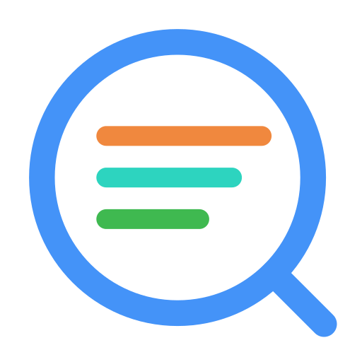
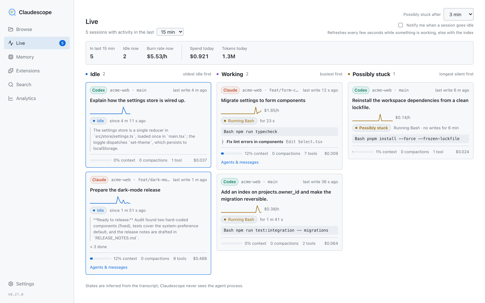
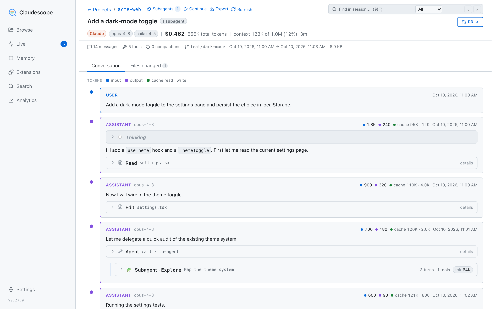
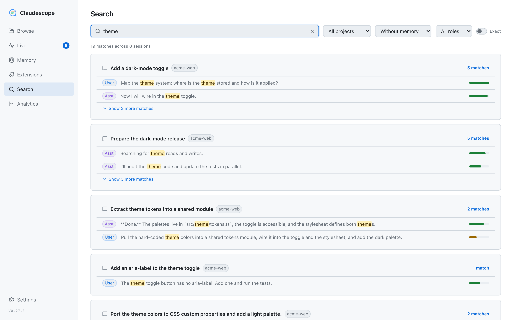
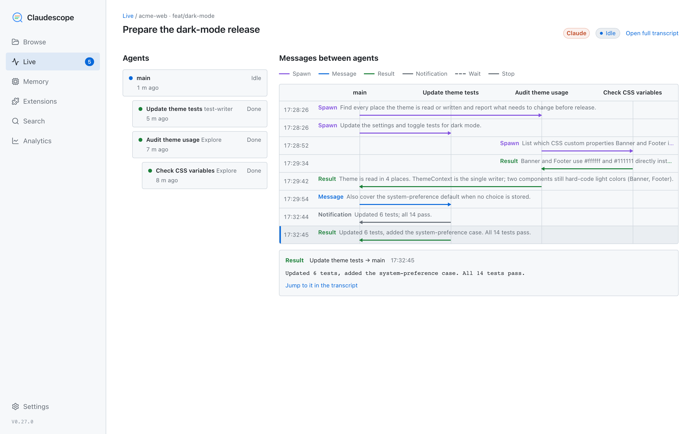
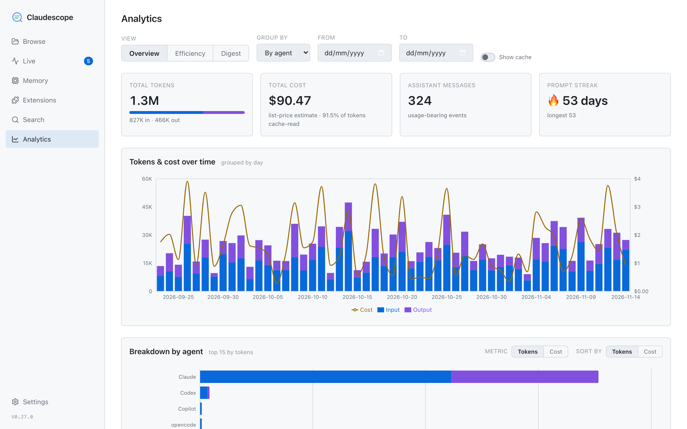
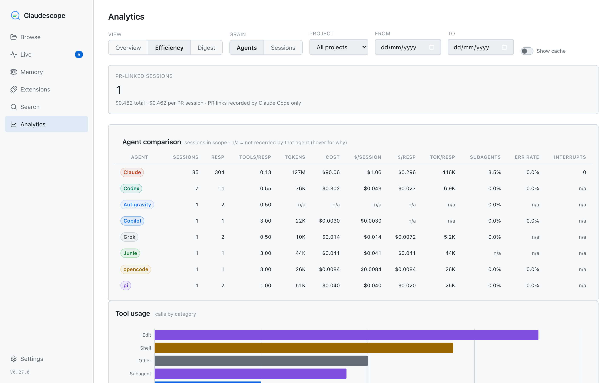
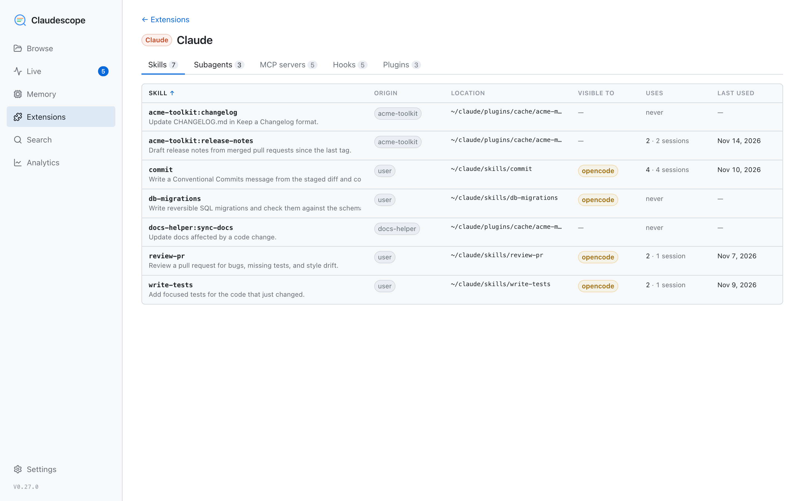

#  Claudescope

[](https://github.com/vladar107/claudescope/actions/workflows/ci.yml)
[](https://www.npmjs.com/package/@vladar107/claudescope)
[](https://nodejs.org)
[](./LICENSE)

**git log for your coding agents.** One place to see what every one of them did.

**[Website](https://claudescope.ramazaev.dev)** · **[Install](#quick-start)** · **[Docs](docs/README.md)** · **[Raycast](https://www.raycast.com/vladar107/claudescope)**

Claudescope is a **local, read-only** app for the transcripts your coding agents
leave on disk. Sessions from [Claude Code](https://claude.com/claude-code),
[OpenAI Codex](https://openai.com/codex), [GitHub Copilot CLI](https://github.com/features/copilot),
[JetBrains Junie](https://www.jetbrains.com/junie/), [opencode](https://opencode.ai),
[pi](https://pi.dev), [Google Antigravity](https://antigravity.google) and
[xAI Grok CLI](https://x.ai) are **merged under one project per directory**, so
you can read them, search them, price them and watch them live.

<picture>
  <source media="(prefers-color-scheme: dark)" srcset="docs/screenshots/live-dark.png">
  
</picture>

**Live** — every session written to in the last few minutes, in Idle, Working and
Possibly stuck lanes, with the tool running now, its subagents, context and cost.

## What it can do

<table>
  <tr>
    <td width="33%" valign="top">
      <a href="docs/screenshots/session-dark.png"><picture><source media="(prefers-color-scheme: dark)" srcset="docs/screenshots/session-dark.png"></picture></a>
      <br><b>Read</b> a session like a code review: thinking, tool calls, red/green diffs, subagent runs, a Files changed tab, and Markdown export with redaction.
    </td>
    <td width="33%" valign="top">
      <a href="docs/screenshots/search-dark.png"><picture><source media="(prefers-color-scheme: dark)" srcset="docs/screenshots/search-dark.png"></picture></a>
      <br><b>Search</b> every session of every agent (DuckDB BM25), or match one exact string such as an error line.
    </td>
    <td width="33%" valign="top">
      <a href="docs/screenshots/agents-dark.png"><picture><source media="(prefers-color-scheme: dark)" srcset="docs/screenshots/agents-dark.png"></picture></a>
      <br><b>Agent trees</b>: subagents nested under the call that started them, and every message between them.
    </td>
  </tr>
  <tr>
    <td width="33%" valign="top">
      <a href="docs/screenshots/analytics-dark.png"><picture><source media="(prefers-color-scheme: dark)" srcset="docs/screenshots/analytics-dark.png"></picture></a>
      <br><b>Analyze</b> tokens and cost over time, by project, model and agent, with the share served from cache.
    </td>
    <td width="33%" valign="top">
      <a href="docs/screenshots/efficiency-dark.png"><picture><source media="(prefers-color-scheme: dark)" srcset="docs/screenshots/efficiency-dark.png"></picture></a>
      <br><b>Compare</b> agents on cost, tokens, cache hits, error rate and interrupts — n/a when a format doesn't record it, never a fake zero.
    </td>
    <td width="33%" valign="top">
      <a href="docs/screenshots/extensions-dark.png"><picture><source media="(prefers-color-scheme: dark)" srcset="docs/screenshots/extensions-dark.png"></picture></a>
      <br><b>Extensions and memory</b>: every skill, MCP server, hook and plugin each agent loads, plus its instruction files and distilled memory.
    </td>
  </tr>
</table>

## Quick start

Every channel installs the same app. It runs in the background at
**http://localhost:4317**, keeps indexing new sessions, and updates with
`claudescope update`.

### npm

Requires [Node.js](https://nodejs.org) 22.13 or newer.

```bash
npm install -g @vladar107/claudescope
claudescope            # starts the app in the background and opens your browser
```

### Homebrew (macOS / Linux)

```bash
brew tap vladar107/tap
brew install claudescope
claudescope
```

### Nix (any platform)

```bash
nix run github:vladar107/claudescope               # run without installing
nix profile install github:vladar107/claudescope   # or add it to your profile
```

## Ask it from your agent

Claudescope is also an MCP server, a Claude Code and Codex plugin, and a CLI, so
an agent can ask "have I hit this error before?" before it tries again:

```bash
claude mcp add claudescope -- claudescope mcp           # MCP, for any client

claudescope search --literal "ENOENT" --limit 5         # the same from a terminal
claudescope sessions --cwd "$PWD" --sort cost           # this project's priciest sessions
claudescope live --window 5                             # what every agent is doing now
```

In Claude Code, the plugin needs no MCP registration:

```text
/plugin marketplace add vladar107/claudescope
/plugin install claudescope@claudescope
```

Codex, the tool list and every flag: [Agent access](docs/agent-access.md) and [Command line](docs/cli.md).

## Raycast

<a href="https://www.raycast.com/vladar107/claudescope"></a>

On macOS, search every indexed session, browse recent ones, and see which agents
are waiting for you, then jump to the exact message in the app.

## Privacy

Claudescope runs entirely on your machine. It treats every agent's data as
**read-only**, **binds to `127.0.0.1` only**, and sends **no telemetry**. Its
only state is `~/.claudescope/`, safe to delete anytime. The only outbound
requests are a daily version check, a daily refresh of public model prices, and
DuckDB's own extension download on first run.
[`SECURITY.md`](./SECURITY.md) has the full breakdown and how to report a vulnerability.

## Documentation

- [Install and run](docs/install.md) — every channel, updating, running from source
- [Command line](docs/cli.md) — all commands and the query subcommands for scripts
- [Agent access](docs/agent-access.md) — MCP server, Claude Code and Codex plugin, Raycast
- [Supported agents](docs/agents.md) — where each agent's transcripts are read from, and what each format records
- [Configuration](docs/configuration.md) — environment variables and the Settings page
- [Cost methodology](docs/cost.md) — how costs are estimated, and how to override prices
- [Usage notes](docs/usage.md) · [Troubleshooting](docs/troubleshooting.md) · [Architecture](docs/architecture.md)

## Contributing

Contributions are welcome. The dev loop, the tests, how to add a connector for
another agent, and the release process are in [`CONTRIBUTING.md`](./CONTRIBUTING.md).

## License

[MIT](./LICENSE) © Vladislav Ramazaev
